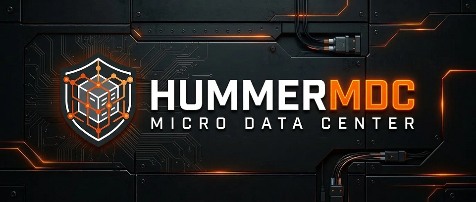
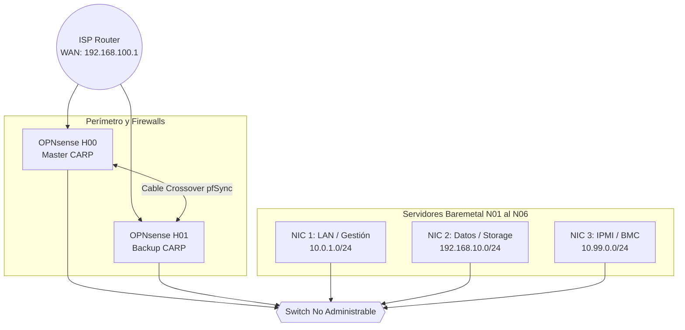

---

# 🏗️ HummerMDC — Micro Data Center (V0.1)

> Infraestructura self-hosted de Alta Disponibilidad (HA) para IA (RAG/MCP), Domótica y Sistemas Críticos Empresariales (Odoo ERP). Orquestación bare-metal con cero dependencias cloud y control absoluto de datos.

---
Bienvenido a **HummerMDC**, el Micro Data Center (MDC) de producción de **Hummerfire SpA**. 

Este proyecto nacio como un [*Homelab*](https://github.com/HummerFire/HummerLab-Infrastructure), evolucionando como respuesta a las necesidades de desarrollo empresarial. Infraestructura crítica diseñada bajo los principios de **Filosofía OUTLIER** (cero dependencia de la nube, hardware declarado obsoleto pero de alto rendimiento y soberanía absoluta de los datos) para sostener el ecosistema de **Spareware SpA** y futuras expansiones.

---

## 🏛️ El Ecosistema

### I. **Hummerfire SpA (Holding):** Startup Matriz encargada de las decisiones estratégicas globales.
* **HummerMDC (Infraestructura):** El motor tecnológico que servicios selfhosted y cloud para sus filiales.
### II. **Spareware SpA (Retail):** PYME filial encargada del retail. 

---

## ⚙️ Stack Tecnológico Principal
El diseño de la V0.1 prioriza la Alta Disponibilidad (HA) donde genera ingresos, y la eficiencia extrema donde no.

*   **Virtualización:** Proxmox VE (3 Nodos Baremetal).
*   **Cloud-Native / K8s:** Talos OS administrado con Sidero Omni (3 Nodos Baremetal).
*   **ERP:** Odoo (Stateless) + Nginx (Longpolling).
*   **Base de Datos:** PostgreSQL + Patroni (HA) + PgBouncer + TimescaleDB + PgVector.
*   **Caché / Sesiones:** Valkey + Sentinel.
*   **Almacenamiento:** TrueNAS (NFS) + MinIO (S3 distribuido).
*   **Red y Balanceo:** OPNsense (CARP) + HAProxy + Keepalived + Wireguard.
*   **Observabilidad:** Prometheus, Grafana, Loki, OpenTelemetry.

---

## 🗺️ Topología del Sistema

### Mapa Físico (Baremetal)

